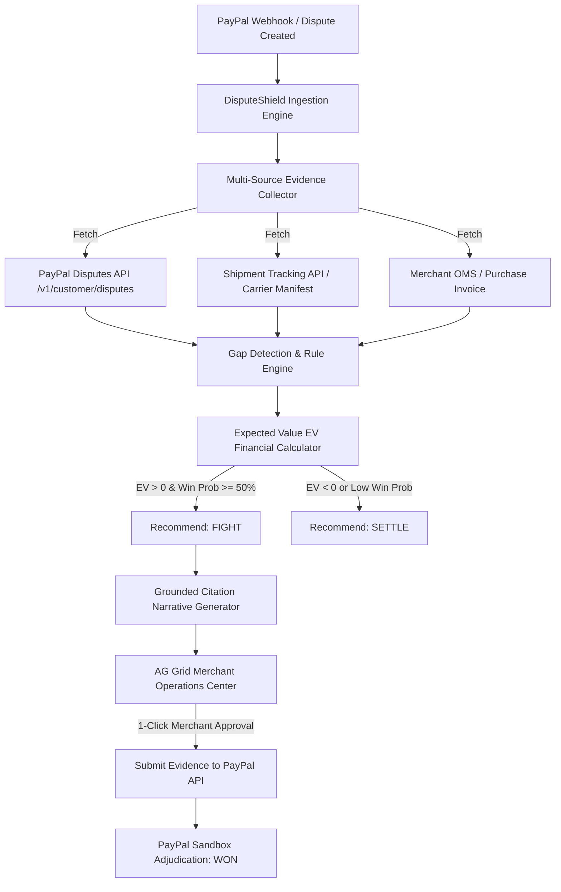

# DisputeShield AI 🛡️
### Autonomous Dispute Evidence Autopilot & AG Grid Operations Command Center
**Built for the PayPal AI Hackathon 2026 & AG Grid Partner Prize**

[](https://developer.paypal.com)
[](https://www.ag-grid.com)
[](https://www.typescriptlang.org)
[](https://developer.paypal.com/docs/api/disputes/v1/)

---

## 💡 The Problem
Chargebacks and payment disputes are an existential risk for small and medium e-commerce merchants:
1. **Scattered Proof:** Evidence is fragmented across courier trackers, Shopify/Woo receipts, warehouse manifests, and PayPal transaction records.
2. **Strict Deadlines:** Merchants have only 7–10 days to respond to claims. Missing the deadline forfeits both the money and the inventory.
3. **Weak Defense Packets:** Sellers don't know what PayPal's dispute adjudication algorithms look for (e.g. proof of delivery timestamps matching registered postal addresses).
4. **Negative EV Fights:** Merchants waste hours fighting ₹150 claims with weak proof, accumulating non-refundable dispute fees instead of settling smartly.

---

## ⚡ The Solution: DisputeShield AI
**DisputeShield AI** acts as a 24/7 AI paralegal for merchants:
1. **Webhook Ingestion:** Listens to `CUSTOMER.DISPUTE.CREATED` / `CUSTOMER.DISPUTE.UPDATED`.
2. **Autonomous Multi-Source Gathering:** Simultaneously queries PayPal Disputes API, Carrier Shipment Tracking APIs (BlueDart, Delhivery, etc.), and store order manifests.
3. **Gap Detection Engine:** Flags missing proof (e.g., in-transit status vs confirmed delivery, signature POD requirement for orders > ₹3,000).
4. **Transparent EV Financial Decision Matrix:**
   $$\text{EV}_{\text{fight}} = (\text{WinProb} \times \text{Amount}) - ((1 - \text{WinProb}) \times (\text{Amount} + \text{CostOfGoods} + \text{DisputeFee}))$$
   $$\text{EV}_{\text{settle}} = -\text{CostOfGoods}$$
   *Only recommends fighting when the mathematical expected gain is strictly positive.*
5. **Zero-Hallucination Grounded Evidence Drafting:** Compiles a legally rigorous rebuttal letter where **every single sentence cites an exact evidence ID** (`claims_json`). The LLM cannot invent facts.
6. **AG Grid Executive Operations Center:** High-performance dashboard with live risk meters, deadline countdowns, win probability gauges, and one-click approvals.
7. **Instant PayPal Sandbox Transmit & Adjudication:** Submits rebuttal packets via `POST /v1/customer/disputes/{id}/provide-evidence` and demonstrates instant resolution via PayPal Sandbox adjudicate endpoints.

---

## 🏗️ System Architecture & Workflow



---

## 🌟 Why This Project Stands Out

| Criteria | Typical Hackathon Project | DisputeShield AI |
| :--- | :--- | :--- |
| **PayPal API Depth** | Simple checkout button | **Triple API integration**: Disputes API + Tracking API + Orders API + Webhooks |
| **Sponsor Alignment** | Standard HTML table | **AG Grid Operations Center** qualifying for dedicated sponsor cash prizes |
| **AI Reliability** | Unchecked LLM prompt | **Zero-hallucination citation graph** (`claims_json` with verifiable IDs) |
| **Financial Intelligence** | Binary guesses | **Transparent EV formula** balancing profit margins vs dispute fees |
| **Prevention Value** | Reactive only | **Carrier Prevention Radar** identifying high-risk routes and couriers |

---

## 🚀 Quickstart Guide

### 1. Prerequisites
- Node.js v18+ (tested on Node v20 & v24)
- npm v9+

### 2. Installation & Quick Start
Clone the repository and launch the full stack with 2 commands:
```bash
git clone https://github.com/your-username/paypal-dispute-shield-ai.git
cd "paypal-dispute-shield-ai"

# 1. Install all dependencies across root, server, and client:
npm run setup

# 2. Launch both Backend (port 5001) & AG Grid Frontend (port 5173):
npm run dev
```

Visit **`http://localhost:5173`** in your browser.

### 3. Configuration (Optional)
The application works **100% out-of-the-box in standalone sandbox mode** with realistic PayPal dispute payloads. To connect your live PayPal Developer credentials or Google Gemini key:
Copy `server/.env.example` to `server/.env`:
```env
PORT=5001
PAYPAL_API_BASE=https://api-m.sandbox.paypal.com
PAYPAL_CLIENT_ID=your_sandbox_client_id
PAYPAL_CLIENT_SECRET=your_sandbox_client_secret
GEMINI_API_KEY=your_gemini_api_key
```

---

## 🎬 3-Minute Demo Video Walkthrough

1. **Minute 0:00 - 0:45 (The Problem & Command Center):**
   * Show the AG Grid dashboard with open disputes, at-risk capital, and the countdown timer.
   * Highlight the **Ravi Sharma** case (Urban Voyager Backpack, ₹1,499) flagged as `Action Required`.
2. **Minute 0:45 - 1:30 (The AI Agent at Work):**
   * Click **"Review Packet"** to open the inspection drawer.
   * Point out the **EV Financial Box**: Win Prob (82%), Fight EV (+₹734.20) vs Settle EV (-₹580.00).
   * Show the **Evidence Checklist** (Courier proof, address match, lack of physical signature flagged).
3. **Minute 1:30 - 2:15 (Zero Hallucination Citations & Human Approval):**
   * Show the drafted narrative. Click **"Citation #2"** to watch the UI highlight the courier tracking record, proving no hallucinations occurred.
   * Click **"Approve & Submit to PayPal"** to trigger the PayPal Disputes API call.
4. **Minute 2:15 - 2:45 (Instant Adjudication & Prevention):**
   * Click **"Simulate PayPal Won"** to trigger Sandbox Adjudication, firing victory confetti and releasing the hold on funds.
   * Show the **Dispute Prevention Radar**: *"Delhivery/BlueDart have a 91% win rate, while untracked economy couriers account for 70% of lost revenue."*
5. **Minute 2:45 - 3:00 (Simulate Webhook live):**
   * Click **"Simulate Inbound Dispute"** to show a new dispute triaged live in under 2 seconds.

---

## 📜 License
MIT License. Built for the PayPal AI Hackathon 2026.
